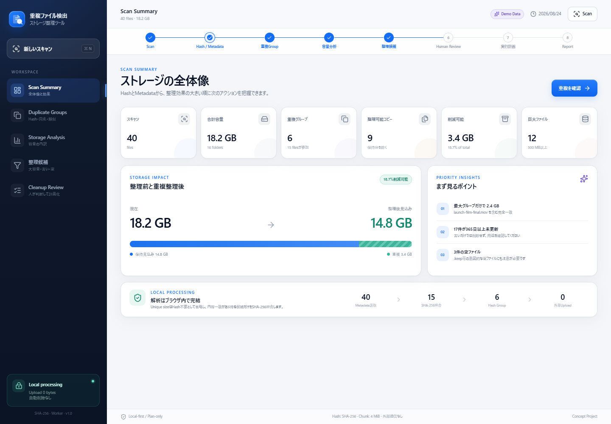
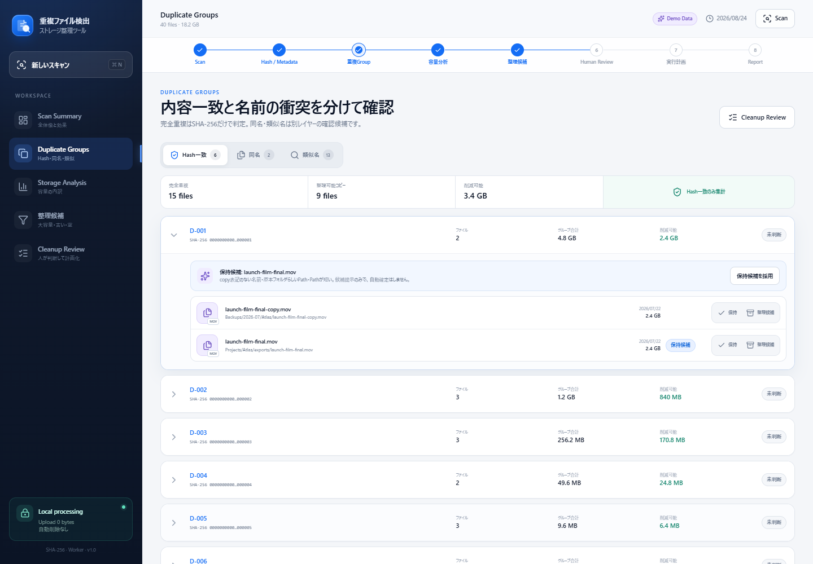
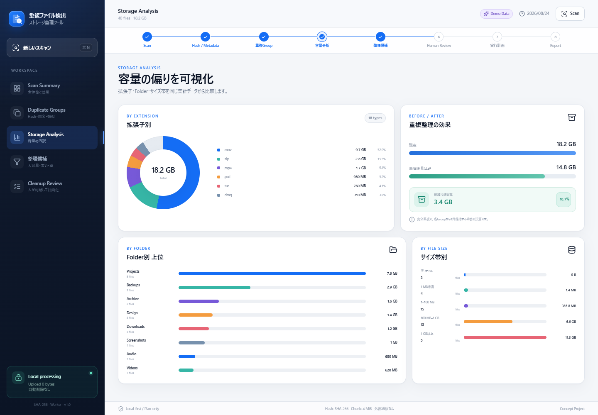
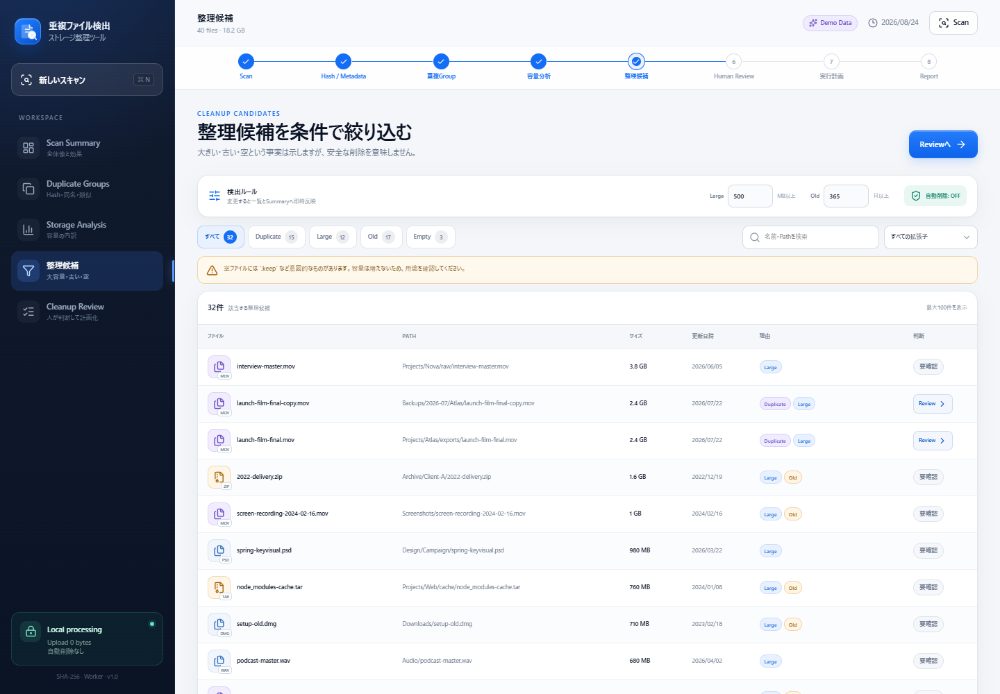
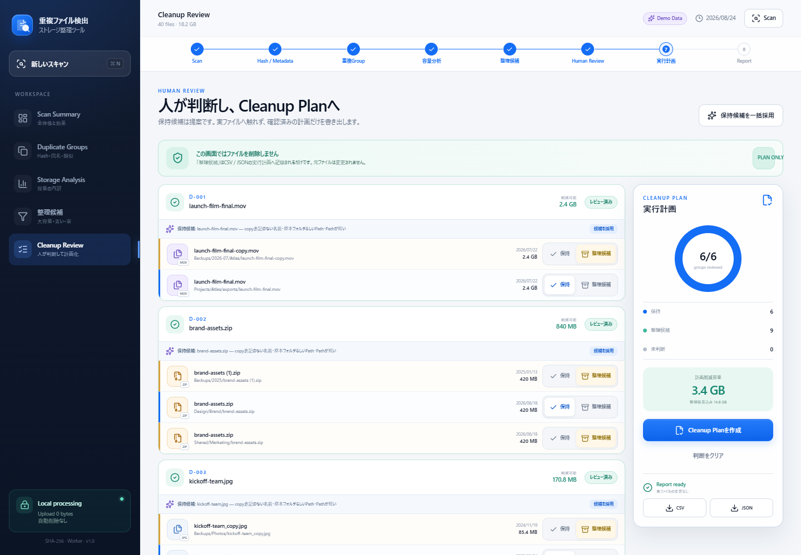

# 重複ファイル検出・ストレージ整理ツール

大量のファイルを端末内で読み取り、SHA-256による完全重複、同名・類似名、巨大・古い・空ファイルを分析するLocal-firstのWeb業務効率化ツールです。検出結果からHuman Reviewを経て整理計画を作り、CSV / JSONへ出力します。

- 本番アプリ: [https://duplicate-file-storage-cleanup-tool.vercel.app](https://duplicate-file-storage-cleanup-tool.vercel.app)
- ソースコード: [https://github.com/shunsoco-stack/duplicate-file-storage-cleanup-tool](https://github.com/shunsoco-stack/duplicate-file-storage-cleanup-tool)
- QA: [docs/QA.md](docs/QA.md)
- ポートフォリオ掲載用完全版プロンプト: [docs/PORTFOLIO_COMPLETE_PROMPT.md](docs/PORTFOLIO_COMPLETE_PROMPT.md)
- スクリーンショット仕様: [docs/screenshots/README.md](docs/screenshots/README.md)

## コンセプト

単なるファイル一覧ではなく、次のStorage Cleanup Workflowを1つの画面で追えるように設計しています。

```text
Scan
↓
Hash / Metadata解析
↓
重複Group化
↓
容量分析
↓
整理候補
↓
Human Review
↓
実行計画
↓
Report
```

ここでいう「実行計画」は、実ファイルの削除ではありません。本バージョンの安全モードは `plan-only` であり、ユーザーが「保持」または「整理候補」を明示的に判断し、その結果をレポートにするところまでを対象とします。

## 主な機能

- File System Access APIによるフォルダ選択と再帰読み取り
- 非対応環境向けのフォルダー / 複数ファイル選択Fallback
- Drag & Dropとファイル選択
- ファイル名、拡張子、サイズ、更新日時、取得できる範囲の相対Path表示
- ファイル内容のSHA-256による完全重複Group化
- 同名ファイルと類似名ファイル候補の分離表示
- Group合計容量、冗長Copy数、削減可能容量のコード算出
- 拡張子別、Folder別、サイズ帯別の容量分析
- Large閾値とOld経過日数の変更
- Duplicate / Large / Old / Empty / Extensionの絞り込み
- 自動確定しないKeep Recommendation
- グループ単位のHuman Review
- UTF-8 BOM付きCSVとJSONのCleanup Plan出力
- 実ファイルがなくても全フローを試せる40ファイルの架空Demo
- Files + Magnifying Glass + Duplicateをモチーフにした専用アイコン

専用アイコンは [`public/icons/storage-cleanup-mark.svg`](public/icons/storage-cleanup-mark.svg) に格納し、App Router用の [`src/app/icon.svg`](src/app/icon.svg) と同じモチーフを使っています。

## Local-first / Privacy

実ファイルの読み取り、Hash、メタデータ分析、Group化、Filter、Review、Report生成はブラウザ内で完結します。

- 入力ファイル本体をアプリのサーバーへUploadしない
- ファイル内容やHashをURLに含めない
- サーバーAPI、Database、Cloud Storageを使用しない
- Next.jsのStatic ExportをVercelから配信する
- 出力レポートはブラウザがローカルで生成する

これは本アプリ自身のデータフローに対する説明です。利用端末、ブラウザ、拡張機能、端末管理ソフト、Hostingの運用ポリシーまで保証するものではありません。

## Folder InputとBrowser Fallback

### 1. File System Access API

`window.showDirectoryPicker({ mode: "read" })` が使える場合は、選択したDirectory Handleを読み取り専用で取得し、配下を再帰的に列挙します。アプリがWrite Permissionを要求することはありません。

### 2. Folder / multiple file fallback

Directory Picker未対応ブラウザでは、`webkitdirectory` / `multiple` のFile Inputを使います。`webkitRelativePath`が提供される場合は相対Pathを保持し、取得できない場合はファイル名のみをPathとして扱います。

Browser APIの制約上、端末内の絶対Pathは取得・表示しません。

## 完全重複検出

完全重複の判定にファイル名は使いません。実スキャンでは次の手順を使います。

1. `File.size` でファイルを事前Group化する。
2. 同じサイズのファイルが2件以上あるGroupだけをHash対象にする。サイズが異なるファイルは同一内容ではないため、不要な読み取りを避ける。
3. 対象ファイルを `4 * 1024 * 1024` byte、つまり4 MiBずつ `File.slice()` で読み取る。
4. Web Worker内の増分SHA-256実装へ各chunkを順次渡し、64文字の16進digestを生成する。
5. SHA-256が同じファイルを1つのDuplicate Groupとする。

Web Workerが使えない環境では、同じ4 MiBの増分方式をメインスレッドで実行します。chunk間でevent loopへ制御を返しますが、通常はWorkerを優先します。

0 byteファイルは容量削減効果がないためHash対象にせず、Duplicate KPIにも含めません。`Empty`候補として別に表示します。

### 算出式

```text
exactDuplicateGroup
= 同一SHA-256の非空ファイルが2件以上

groupTotalBytes
= Σ group.files[].size

groupReclaimableBytes
= groupTotalBytes - group内の1ファイル分のsize

reclaimableBytes
= Σ groupReclaimableBytes

redundantCopyCount
= Σ (group.files.length - 1)
```

同じHash Group内では各ファイルのサイズは同じであるため、1件を保持した場合の理論上の削減上限を上式で求めます。実際に回収できるディスク容量は、hard link、filesystem compression、snapshot、cloud placeholderなどの影響で異なる場合があります。

## 同名・類似ファイル名

- 同名検出はUnicode NFKC正規化、前後空白除去、日本語Localeでの小文字化後の名前を比較します。
- 類似名検出は同じ拡張子を前提に、`copy` / `backup` / `final` / `master` / version表記などを除いたstemのLevenshtein類似度を使います。現在の候補閾値は0.72です。
- 同名・類似名は「確認候補」であり、内容一致を意味しません。完全重複の集計にはSHA-256一致だけを使います。

類似名検出は大規模入力の比較量を抑えるため、拡張子と正規化stemの先頭でbucket化しています。このため全組合せを比較する検索ではなく、候補の見逃しがあり得ます。

## Keep RecommendationとSafety

Duplicate Group内では、次のheuristicを使って保持候補と判断理由を提示します。

1. `backup` / `archive` / `downloads` / `temp` 等のPathを優先度を下げる
2. `copy` / `backup` / `old` / `コピー` / `複製` / 連番等を含む名前の優先度を下げる
3. Pathの階層と文字数が短いものを優先する
4. 同条件では更新日時が新しいものを優先する

この推奨は自動適用しません。ユーザーは各ファイルを「保持」「整理候補」「未判断」として明示的にレビューします。Groupのレビュー完了には、全件が判断済みであり、かつ1件以上の保持が必要です。

アプリはファイルの削除、移動、名称変更を実行しません。出力されるのは整理候補の計画であり、実ファイルへの操作はユーザーの別工程です。

## 分析・Filter

既定値は次のとおりです。

| 項目 | 既定値 | 判定 |
| --- | ---: | --- |
| Large | 500 MiB | `size >= thresholdBytes` |
| Old | 365日 | `modifiedAt > 0` かつ `now - modifiedAt >= thresholdDays` |
| Empty | 0 byte | `size === 0` |

`modifiedAt === 0` のファイルは1970年のファイルとはみなさず、Old判定から除外します。Large閾値とOld日数はUIから変更でき、集計と候補一覧に即時反映されます。

容量分析は拡張子別、最上位Folder別、次のサイズ帯別に件数とbyte合計を算出します。

- 空ファイル
- 1 MB未満
- 1–100 MB
- 100 MB–1 GB
- 1 GB以上

## Demo Mode

Demoは完全に架空の40ファイルで構成されます。Demo用HashはGroupを再現するfixtureであり、実ファイルのdigestではありません。実スキャンでは常に内容からSHA-256を計算します。

2026-08-24 10:30 JSTを判定基準にコードから算出した初期値です。

| KPI | Demo値 |
| --- | ---: |
| スキャンファイル | 40件 |
| 合計容量 | 18.25 GiB |
| 完全重複Group | 6Group |
| 重複Group参加ファイル | 15件 |
| 冗長Copy | 9件 |
| 削減可能容量 | 3.42 GiB |
| 重複整理後の理論容量 | 14.83 GiB |
| Large（500 MiB以上） | 12件 |
| Old（365日以上） | 17件 |
| Empty | 3件 |

Demoの合計には二進単位の係数を使い、表は小数第2位に丸めています。UIの容量表記は1024進で計算し、読みやすい `KB` / `MB` / `GB` ラベルを使います。

## Cleanup Plan Export

CSVはExcel等で開きやすいUTF-8 BOM付きです。ファイル名、Path、理由等の文字列が空白に続く `=` / `+` / `-` / `@` で始まる場合はapostropheを付け、spreadsheet formulaとして評価されるリスクを抑えます。次の列を出力します。

```text
group_id
action
recommended
reason
path
filename
extension
size_bytes
last_modified
sha256
```

JSONは `schemaVersion: "1.0"`、`safetyMode: "plan-only"`、`hashAlgorithm: "SHA-256"`、閾値、スキャンサマリ、レビュー済みGroup数、計画上の整理候補数・容量、各ファイルの判断を保持します。未判断ファイルは計画itemに含めません。

## Architecture

```text
Next.js App Router / Static Export
└─ Client UI
   ├─ Folder / File / Drop input
   ├─ Metadata records
   ├─ Hash Worker client
   │  └─ size pre-group → 4 MiB incremental SHA-256
   ├─ Analyzer
   │  ├─ exact duplicate groups
   │  ├─ same / similar names
   │  ├─ large / old / empty
   │  └─ extension / folder / size breakdown
   ├─ Human Review state
   └─ CSV / JSON Cleanup Plan
```

Static Export構成のため、本番配信に入力処理用のServer Functionは必要ありません。

## Tech Stack

- Next.js 16.3 / App Router / Static Export
- React 19.2
- TypeScript 5.9
- Web Worker / File System Access API / File API
- 増分SHA-256（プロジェクト内のTypeScript実装）
- Lucide React
- Vitest 4 / Testing Library / jsdom
- ESLint 9 / eslint-config-next

## Getting Started

要件: Node.js 22以上、npm

```bash
npm install
npm run dev
```

開発Server起動後、ターミナルに表示されるlocalhost URLをブラウザで開いてください。

## Scripts

| Command | 内容 |
| --- | --- |
| `npm run dev` | Next.js開発Server |
| `npm run lint` | ESLint |
| `npm run typecheck` | Next route type生成とTypeScript型検査 |
| `npm run test` | Vitestを1回実行 |
| `npm run test:watch` | Vitest watch mode |
| `npm run build` | `out/`へProduction Static Export |
| `npm run verify` | lint → typecheck → test → build |

## Testing

Unit Testは以下を対象とします。

- SHA-256の標準test vector（空入力、`abc`）
- 任意chunk分割でも同じSHA-256になること
- SHA-256による完全重複Groupと削減容量
- 同名でHashが異なるファイルを完全重複にしないこと
- 類似名正規化
- 明示的なReview結果だけから `plan-only` 計画を作ること
- CSV / JSON出力でSHA-256を保持すること
- ファイル由来のCSV文字列に対するspreadsheet formula injectionの無効化

一括検証:

```bash
npm run verify
```

実行済みの結果と手動Browser QAは [docs/QA.md](docs/QA.md) に記録します。

## Vercel Deployment

`next.config.ts` は `output: "export"`、`vercel.json` は次の構成です。

```json
{
  "framework": null,
  "buildCommand": "npm run build",
  "outputDirectory": "out"
}
```

VercelでプロジェクトのRoot Directoryをこのフォルダに設定し、ProductionへDeployします。

```bash
vercel --prod
```

公開後は本番URLのHTTP応答、アプリ名、Demoの主要KPI、CSV / JSON出力、スクリーンショット対象画面を再確認します。

## GitHub公開とSecret Scan

公開前に、最低限次を確認します。

```bash
npm run verify
git status --short
git diff --check
git grep -nEi "(api[_-]?key|secret|token|password|private[_-]?key)"
```

Repository内の`.env*`、設定ファイル、build outputも手動で確認し、利用可能な場合はGitleaks等の専用scannerを併用します。検索語の一致だけでSecretの有無を判断せず、検出結果を内容と使用箇所に基づいてレビューしてください。

## Accessibility / Design

- システムフォント、明確な視覚階層、控えめなTranslucent Material
- ユーザーの明示操作を優先するAgencyと `plan-only` の安全設計
- 色だけに依存しないラベル、数値、表の併記
- Keyboard focusの可視化とセマンティックなlandmark / table
- `prefers-reduced-motion`、`prefers-reduced-transparency`、`prefers-contrast`への配慮
- Desktop中心の情報密度を保ちながらTablet / Mobileに再配置するResponsive UI

Apple Designの「Safety / Predictability」「Agency」「Simplicity」を中心に、分析の派手さよりも、ローカル処理、判定根拠、未実行状態が予測できることを優先しています。

## Screenshots

次の5枚はVercel ProductionのDemo Modeから取得するポートフォリオ用画像です。取得条件と正確なaltは [docs/screenshots/README.md](docs/screenshots/README.md) を参照してください。

1. Scan Summary

   
2. Duplicate Groups

   
3. Storage Analysis

   
4. Large / Old Files

   
5. Cleanup Review

   

## Known Limitations

- 実ファイルの削除、移動、名称変更は実装していません。出力は整理計画のみです。
- File System Access APIの対応状況と許可UIはブラウザに依存します。非対応環境ではFallbackを使います。
- Browserは端末の絶対Pathを通常公開しません。表示できるのは選択元からの相対Pathまたはファイル名です。
- Symbolic linkとhard linkの識別、filesystemのallocated size、cloud-only placeholderの実容量はBrowser File APIから取得できません。
- SHA-256一致を完全重複の実用的な根拠として扱いますが、cryptographic collisionの理論的可能性を0と主張するものではありません。
- ファイル数・容量の上限と所要時間は端末性能、Browser、ストレージ速度に依存します。全環境の速度を保証しません。
- スキャン中に外部アプリがファイルを更新した場合の一貫したsnapshotを保証しません。
- 類似名はheuristic候補であり、全類似ファイルの検出保証や内容一致判定ではありません。
- 類似名は各bucketの先頭80ファイルを比較対象とし、score上位24pairまでを表示します。整理候補テーブルは現在のFilter / Search結果の先頭100件までを表示します。
- Keep RecommendationはPathと名前と更新日時のheuristicであり、業務上の正式版を識別するものではありません。
- 現在のスキャン結果、閾値、Review状態はページのメモリ上にだけ保持され、リロードやタブ終了をまたいで永続化・共有しません。
- アカウント、サーバー保存、複数人での共有・承認、監査ログは実装していません。

## Portfolio Metadata

- カテゴリ: 業務効率化ツール
- サブカテゴリ: ストレージ・ファイル管理
- アプリ名: 重複ファイル検出・ストレージ整理ツール
- アイコンモチーフ: Files + Magnifying Glass + Duplicate
