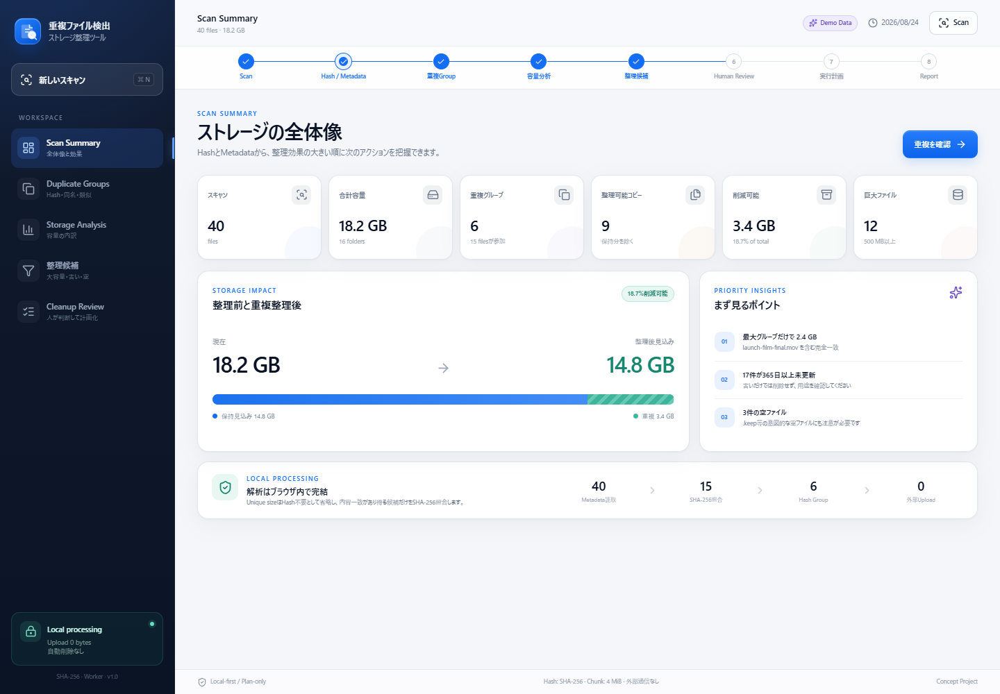
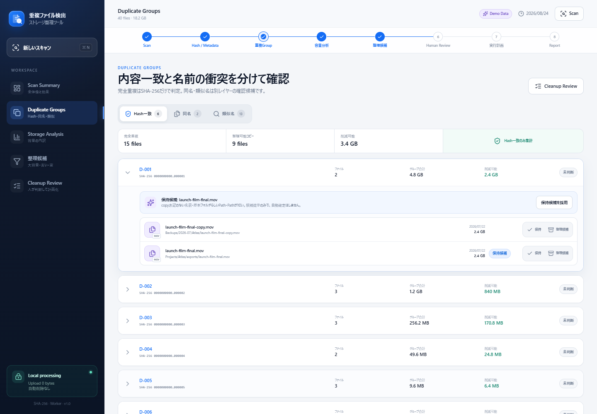
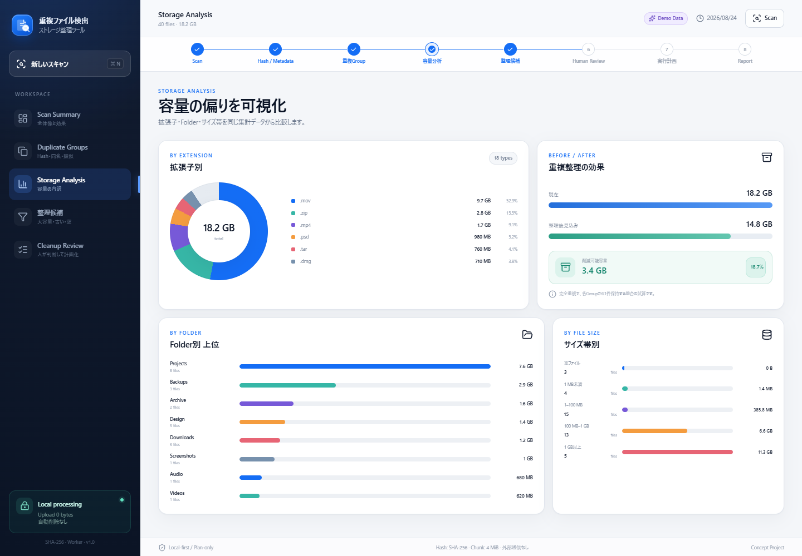
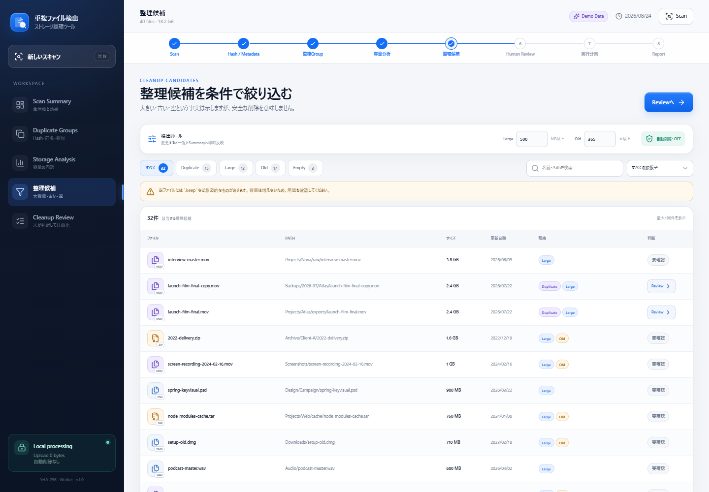
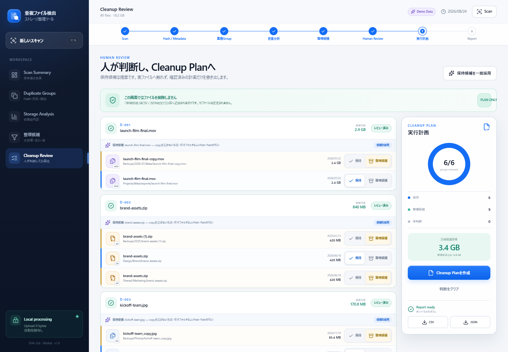

# Portfolio Screenshots

「重複ファイル検出・ストレージ整理ツール」のポートフォリオ用必須スクリーンショット5枚の仕様です。

画像はデモデータを使い、Vercel Production `https://duplicate-file-storage-cleanup-tool.vercel.app` の実画面から取得しました。入力元の実ファイル名、絶対Path、Browser profile情報、ローカルのURLは映していません。

## 共通キャプチャ条件

- Desktop viewport: 1440 × 1000 pxを基準
- Device scale factor: 1
- Browser zoom: 100%
- Light theme
- Demoの基準日: 2026-08-24
- Large閾値: 500 MiB
- Old閾値: 365日
- スキャン中ではなく、描画とmotionが収束した状態
- 重要なKPI、Hash一致、Local-first、`plan-only` の文言が読める解像度

## 1. Scan Summary

- Filename: `01-scan-summary.png`
- Caption: ローカルスキャンから整理効果までを一望するScan Summary
- Alt: `40ファイル、合計18.2 GB、完全重複6Group、整理可能Copy 9ファイル、削減可能3.4 GB、Large 12件を示すスキャン概要画面`

含める要素:

- アプリ名とFiles + Magnifying Glass + Duplicateの専用アイコン
- Local-first / ファイル非Uploadの表示
- Scan → Hash / Metadata → Group → Analysis → Review → Plan / ReportのWorkflow
- 40ファイル、18.2 GB、6Group、9件、3.4 GB、Large 12件の主要KPI
- 重複整理後の理論容量14.8 GB

```md

```

## 2. Duplicate Groups

- Filename: `02-duplicate-groups.png`
- Caption: SHA-256一致の根拠と保持候補を確認できるDuplicate Group
- Alt: `SHA-256が一致するlaunch filmの2ファイル、Group合計4.8 GB、削減可能2.4 GB、保持推奨理由を表示した重複Group画面`

含める要素:

- `Hash一致`、`同名`、`類似名` の区別
- D-001 `launch-film-final.mov` Groupの展開状態
- SHA-256の短縮表示またはHash一致の明示
- 2ファイルの名前、相対Path、更新日時、サイズ
- Group合計4.8 GB、削減可能2.4 GB
- Keep Recommendationと理由
- 推奨は自動確定されないことが分かるReview control

```md

```

## 3. Storage Analysis

- Filename: `03-storage-analysis.png`
- Caption: どの種類とFolderが容量を使っているかを比較するStorage Analysis
- Alt: `拡張子別、最上位Folder別、サイズ帯別の件数と容量をチャートと数値で示すストレージ分析画面`

含める要素:

- 拡張子別の容量分布
- Folder別の容量順位
- 空 / 1 MB未満 / 1–100 MB / 100 MB–1 GB / 1 GB以上のサイズ帯
- 整理前18.2 GBと完全重複整理後14.8 GBの比較
- 色だけに依存しないラベルと数値

```md

```

## 4. Large / Old Files

- Filename: `04-large-old-files.png`
- Caption: 大容量と長期未更新の根拠から整理候補を絞り込む一覧
- Alt: `Large 500 MiB以上と12件、Old 365日以上と17件を切り替え、ファイル名、相対Path、サイズ、更新日時、候補理由を確認する一覧画面`

含める要素:

- Duplicate / Large / Old / Empty / ExtensionのFilter
- Large = 500 MiB、Old = 365日の現在閾値
- Large 12件、Old 17件の件数
- ファイル名、相対Path、サイズ、更新日時、候補理由
- LargeとOldの複数理由に該当する行
- 古いことだけで自動削除しない安全表示

```md

```

## 5. Cleanup Review

- Filename: `05-cleanup-review.png`
- Caption: ファイルを削除せず、Human Review済みの整理計画だけを出力するCleanup Review
- Alt: `6重複GroupのHuman Review、保持6件、整理候補9件、計画削減3.4 GB、CSV・JSON出力とファイルを削除しない安全表示のあるCleanup Review画面`

キャプチャ前に、ユーザー操作で各6Groupに保持1件と整理候補を設定します。Keep Recommendationを適用できるUIがある場合も、キャプチャ前の明示操作として実行します。

含める要素:

- 「この画面ではファイルを削除しない」ことが分かる表示
- レビュー済み6 / 6Group
- 保持6件、整理候補9件、未判断0件
- 計画削減容量3.4 GB、整理後の理論容量14.8 GB
- CSV / JSONの出力操作
- `plan-only` とSHA-256の表示

```md

```

## 取得後の確認

```powershell
Get-ChildItem docs/screenshots/*.png |
  Select-Object Name, Length
```

- [x] 必須5ファイルが上記の正確な名前で存在する
- [x] 5枚すべてがVercel Productionから取得されている
- [x] 各画像の文字とKPIが読める
- [x] 画像の値とコード算出のDemo値が一致する
- [x] 画像に個人情報、本番以外のURL、絶対Pathがない
- [x] READMEで上記altを使用している
- [x] 5枚とも1440 × 1000 pxで、重要UIを意図せず切り落としていない
